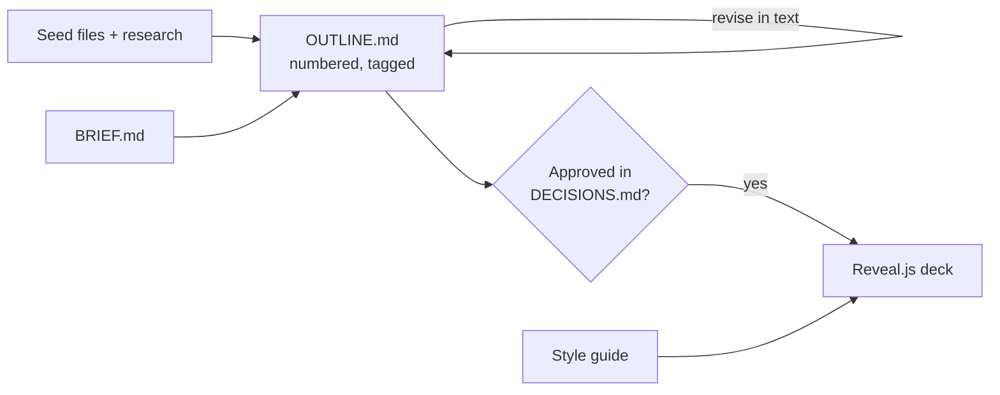

# Two-phase presentation template for Claude Projects

Build a presentation with Claude in two phases: first a structured Markdown **outline**, refined until it's approved, then a two-dimensional **Reveal.js deck** generated from it once. Metadata tags in the outline (tips, warnings, quizzes, exercises, speaker notes, placeholders) carry through to the deck, rendered by a swappable **style guide**.



## Why work this way
- **Text is cheap; decks are expensive.** Revising an outline costs a fraction of revising a built deck, and every "redo the deck" pays for the whole deck again.
- **Chats don't share history.** Progress lives in project files that Claude reads and writes, so any chat can pick up where the last one stopped.
- **Tags separate meaning from look.** The outline says "this is a warning"; the style guide decides what a warning looks like. Swap the guide and the same outline renders in a new theme.
- **Horizontal and vertical slides.** Walking across the top-level slides gives a complete introduction; the slides below each one hold detail for live exploration or self-guided reading on a hosted deck.

## What's in the folder

| Path | Goes where | Purpose |
|---|---|---|
| `PROJECT-INSTRUCTIONS.md` | Project instructions | The general process and rules; the same for every presentation |
| `knowledge/BRIEF.md` | Project knowledge | This presentation's settings: topic, audience, presenter, dates, seeds, sources, style |
| `knowledge/OUTLINE.md` | Project knowledge | Starter outline; Claude maintains it |
| `knowledge/DECISIONS.md` | Project knowledge | Starter decisions log; Claude maintains it |
| `knowledge/WORKFLOW.md` | Project knowledge | Phases, checkpoints, how state files are written |
| `knowledge/OUTLINE-CONVENTIONS.md` | Project knowledge | Numbering, every tag, and what Phase 2 does with each one |
| `knowledge/DECK-BUILD-SPEC.md` | Project knowledge | Phase 2 technical rules, known pitfalls, verification checklist |
| `knowledge/styles/STYLE-*.md` | Project knowledge (the one you use) | Style guides: a blank template, Neutral, and Field Guide |
| `PROMPTS.md` | You | Copy-paste prompts for each stage |
| `tools/check-deck.py` | You or Claude | Checks every slide: visible, no overflow, no footer collision, diagrams rendered, no console errors, no leaked tags |
| `examples/field-guide-demo/` | Reference | A demo outline that uses every tag, the deck built from it, and a tag-to-slide map |

## Quick start
1. Create a Claude Project and paste the text of `PROJECT-INSTRUCTIONS.md` (everything below the horizontal rule) into the project instructions.
2. Upload everything in `knowledge/` except the style guides you won't use (keep any guide your chosen one reuses rules from). Upload your seed files (notes, transcripts, articles) too.
3. In a new chat, use the **Kickoff** prompt from `PROMPTS.md`. Claude interviews you and fills in `BRIEF.md`.
4. Work through Phase 1 with the **First outline**, **Revise**, and **Review** prompts. Claude writes `OUTLINE.md` and `DECISIONS.md` to the project at each checkpoint.
5. **Approve** when the outline is ready. That decision is what opens Phase 2.
6. In a fresh chat, **Start Phase 2**, then run **pass 2**. Open the deck in a real browser to review it.

Open `examples/field-guide-demo/deck.html` first to see what a finished deck looks like, then read its `OUTLINE.md` side by side with it.

## Style guides
- **`STYLE-NEUTRAL.md`:** brand-free; uses GitHub's standard alert types (Note, Tip, Warning).
- **`STYLE-FIELD-GUIDE.md`:** a teaching theme with trail markers, five callouts (Tip, Remember, Watch out, Under the hood, Field note), and three interactive slide types (Quick check, Myth vs fact, Recap).
- **`STYLE-GUIDE-TEMPLATE.md`:** copy it to make your own, such as your organization's brand. Each tag needs a rendering rule, required fields, a frequency limit, and a proposal rule that tells Claude when to use it.

Callouts use GitHub's alert syntax (`> [!TIP]`), so outlines stay readable as plain Markdown on GitHub.

## Checking a deck locally
```bash
pip install playwright && playwright install chromium
python tools/check-deck.py path/to/deck.html --shots shots/
```
Claude runs the same checks in its own sandbox during Phase 2. Without internet access, use `--map` to serve the pinned library files from local copies (see the script's header).

## Scope
This version is for a **single author**. Several people editing one outline from their own chats raises stale-copy and overwrite problems that need their own design. The stable section numbers, decisions that are only ever added (never edited), and version lines in the state files are meant as the foundation for that.

## License
[Choose a license before publishing, e.g., CC BY 4.0 for the documents and MIT for `tools/`.]
