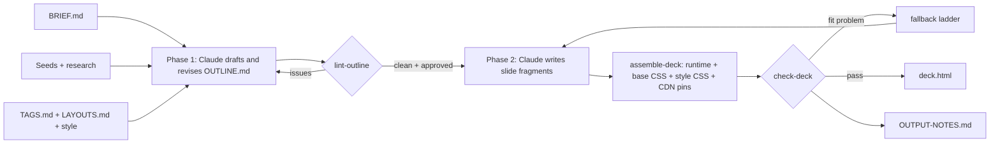

# Outline-to-Deck v2: Plan

Nov 25, 2026 · Terry Tompkins · Status: **draft for review**

This plan turns the workshop repo (v1) into a usable tool (v2). It records the decisions made so far, the design of the unified tag system and SmartArt-style layouts, the tooling that takes deterministic work away from Claude, the build and validation rules, and an inventory of every file v2 needs. Open questions for Terry are collected in §15.

It supersedes `docs/SmartArt-style-layouts-for-outline-to-deck-design.md` (Nov 10) where the two differ, and builds on the guided-workflow work recorded in `docs/transcript-guided-workflow-session-20261115.md`.

---

## 1. Goals and scope

### 1.1 Goals
1. **A usable tool, not a teaching kit.** A clean repo with consistent examples and styles; teaching material moved out of the main path.
2. **One tag system.** Everything now spread across `OUTLINE-CONVENTIONS.md`, each style guide, Toons' `Embed:` and the SmartArt design is merged into one registry, so every file refers to the same tags in the same way.
3. **SmartArt-style layouts.** Authors write bullets; one marker line picks a designed layout (list, process, timeline, columns, hierarchy, radial, matrix, cycle, pyramid, funnel, Venn).
4. **Tooling that carries deterministic work.** A linter, a shared deck runtime, an assembler and an upgraded checker, so Claude writes content and semantic markup instead of re-deriving the deck machinery on every build.
5. **The same output contract.** One self-contained HTML file that opens directly in a browser, with Reveal.js and Mermaid loaded from a CDN at pinned versions.

### 1.2 Non-goals for v2
- A web application (see §14 for the reasoning; revisit later).
- Packaging as a Claude plugin. v2 is *designed* so the plugin move is mostly repackaging, but it ships as a Claude Project.
- Multiple authors on one outline.
- A full outline-to-deck compiler. Claude still writes slide content and markup; tools handle structure, rendering machinery and checks.

### 1.3 Delivery mechanism
v2 stays a **Claude Project**: project instructions, knowledge files (rules, styles, state files, user seeds) and one or more chats. That combination has worked. The main weakness of a Project, getting scripts and runtime files into Claude's sandbox reliably, is addressed in §9.3 and tested first (Milestone 0).

---

## 2. Decisions

| # | Date | Decision |
|---|---|---|
| D1 | 2026-11-15 | Guided-mode orchestration first, then layouts. (Done.) |
| D2 | 2026-11-15 | Keep the Project structure; discuss a plugin later. |
| D3 | 2026-11-24 | v2 is a usable-tool release. Teaching material moves to `teaching/`. |
| D4 | 2026-11-25 | One tag registry (`TAGS.md`). **Every style renders every registered tag.** Styles extend a complete base style and override only what they change. |
| D5 | 2026-11-25 | Layout syntax: a **marker line** (`Layout: process`) directly above an ordinary bullet list. Revisit after trials with real outlines and edge cases. |
| D6 | 2026-11-25 | **Fit problems fall back; meaning problems stop.** Too many items, long labels or overflow trigger a fallback ladder and a note in `OUTPUT-NOTES.md`. An unknown tag or a missing required field stops that slide (nothing is guessed). Revisit after trials. |
| D7 | 2026-11-25 | New state file `OUTPUT-NOTES.md` records every fallback, workaround and build fact. |
| D8 | 2026-11-25 | Tooling order: linter → shared runtime and base CSS → assembler → local library pins → checker upgrades → (later) structured-tag compiler. |
| D9 | 2026-11-25 | Output stays one self-contained HTML file; libraries from a CDN at exact pinned versions. |
| D10 | 2026-11-25 | Authors never write Mermaid. Claude proposes a diagram, the presenter confirms, and Claude writes the Mermaid source (§6). |
| D11 | 2026-11-25 | Move to the current major releases: Reveal.js 6.0.2 and Mermaid 12.3.0 (§8.1), confirmed in Milestone 0. |

---

## 3. Architecture



### 3.1 Who does what

| Work | v1 | v2 |
|---|---|---|
| Research, outline content, proposing tags and layouts | Claude | Claude |
| Checking vocabulary, required fields, limits, numbering, status fields; counting `[TBD]` and `[UNVERIFIED]` | Claude, by reading | **`lint-outline.py`** |
| Slide content and semantic markup per topic | Claude | Claude, to a fixed markup contract |
| Reveal config, page numbers, autofit, lazy Mermaid, fragments | Claude re-writes each build | **`runtime/deck.js`** (inlined) |
| Base CSS for every tag and layout | Claude re-writes each build from prose | **`runtime/base.css`** + **style CSS** (inlined) |
| Geometry for cycle, radial and Venn layouts | (n/a) | **`runtime/deck.js`** computes positions at load |
| Assembling the file, CDN tags, SRI hashes, image inlining, partial rebuilds | Claude writes an ad hoc script | **`assemble-deck.py`** |
| Verification | Claude writes its own checker (v1 checker not in the Project) | **`check-deck.py`**, upgraded and always used |
| Build notes | Chat message only | **`OUTPUT-NOTES.md`** |

The effect: the deck's *machinery* is identical across builds and styles; only content and markup vary.

---

## 4. The tag system

### 4.1 Five forms, one job each

| Form | Syntax | Used for |
|---|---|---|
| **Heading tag** | `### 2.4 [Quick check] Title` (slide type right after the number); working-aid tags at the end: `## 3. Title [All] [Core]` | Whole-slide treatments; outline-only metadata |
| **Inline marker** | `[TBD: …]`, `[UNVERIFIED]`, `[Seed]`, `As of …`, `([Title](url))` inside a bullet | Facts about one statement |
| **Callout** | `> [!TYPE] optional title` block quote | A boxed aside inside a slide |
| **Key line** | `Key: value` at the start of a line | Directives (`Layout:`, `Diagram:`, `Embed:`, `Image:`, `Speaker notes:`) and the required fields of slide types (`Question:`, `Answer:`) |
| **Fenced block** | ```` ```mermaid ````, ```` ```chart ```` | Structured content Claude writes (diagrams) or the author pastes (chart data) |

Square brackets remain a closed vocabulary. Markdown links are fine; anything else in brackets is an error the linter reports.

### 4.2 `TAGS.md`: the registry

One file declares every tag. Each entry has: name, form, scope (slide, block, inline, outline-only), required and optional fields, limits, proposal rule (when Claude adds it in Phase 1), what Phase 2 produces (semantic element and class), and status (stable, new, candidate). The tables use a fixed column order so `outline_parser.py` reads them directly; the registry is the single source for the linter, the build spec and the reference doc.

Style guides no longer *define* tags. They only *skin* them (§7).

### 4.3 Tag inventory for v2

**Working aids (always stripped)**

| Tag | Form | Notes |
|---|---|---|
| `[Seed]`, `[Research]` | Inline / heading end | Origin |
| Audience tags from BRIEF.md (e.g. `[All]`, `[Technical]`) | Heading end | Declared per presentation; the linter reads them from BRIEF.md |
| `[Core]`, `[Brief]`, `[Self-guided]` | Heading end / time plan | Priority; Self-guided gets an agenda label |
| `(outline-only working aid)` | Heading suffix | Changes by version, Time plan, Source reconciliation, Coverage gaps |
| Header lines, Central message, `Main points:` label | Structure | Stripped; `Main points:` bullets become the slide body |

**Content markers (rendered)**

| Tag | Renders as |
|---|---|
| `Speaker notes: …` | `<aside class="notes">` |
| `As of Month D, YYYY` | Footer "As of" label |
| `([Title](url))` | Footer source link |
| `[UNVERIFIED]`, `[UNVERIFIED: reason]` | Pill beside the claim; reason to notes |
| `[TBD: description]` | Placeholder chip |

**Slide types (heading tags)**

| Tag | Required fields | Status |
|---|---|---|
| `[Try it yourself]` | `Time:`, `Steps:`, `Expected outcome:` | Stable |
| `[Quick check]` | `Question:`, `Answer:`; optional `Options:` | Stable (was Field Guide/Toons only) |
| `[Myth vs fact]` | 1–3 `Myth:` / `Fact:` pairs | Stable (was Field Guide/Toons only) |
| `[Recap]` | `Points:` 3–4 bullets | Stable (was Field Guide/Toons only) |
| `[Quote]` | `Quote:`, `Attribution:` (role or published source; never a private individual's name), source link | **New** |
| `[Key figure]` | `Figure:`, `Label:`, plus source and `As of` | **New**; one big number with context |
| `[Backup]` | Any body | **New**; built into an Appendix stack after the last section, `data-visibility="uncounted"`, linked from the slide that refers to it |
| `[Demo]` | `Demo:` what is shown; optional `Image:` fallback screenshot | **Candidate** |

**Callouts**

| Canonical type | Purpose | GitHub alias that maps to it |
|---|---|---|
| `NOTE` | Useful context | (native) |
| `TIP` | A better way to do something | (native) |
| `REMEMBER` | The one takeaway of a slide | `IMPORTANT` |
| `WATCHOUT` | A hazard or common mistake | `WARNING`, `CAUTION` |
| `UNDERTHEHOOD` | Technical depth others can skip | — |
| `FIELDNOTE` | A real example or observed result | — |

Aliases live in `TAGS.md`, not in style fallback tables. Every style renders all six (§7). *(Open question Q1.)*

**Directives (key lines)**

| Directive | Meaning | Status |
|---|---|---|
| `Layout: name[; option…]` | Render the bullet list directly below as a designed layout (§5) | **New** |
| `Diagram: plain-language description` | A diagram Claude designs; the Mermaid block Claude writes sits directly below it (§6) | **New** (replaces bare Mermaid blocks) |
| `Suggested visual: description` | An illustrative inline SVG Claude designs; captioned "Illustrative, not measured data" unless drawn from outline numbers | Stable |
| `Embed: url` + optional `Caption:` | A framed live page; prints as a link | **Formalized** (was Toons only) |
| `Image: path-or-url` + required `Alt:` + optional `Caption:` | A picture; local files are inlined as data URIs by the assembler | **New** |

**Fenced blocks**

| Block | Who writes it | Status |
|---|---|---|
| ```` ```mermaid ```` | Claude only, under a `Diagram:` line | Stable |
| ```` ```chart ```` | The author or Claude, from real numbers only | **New** (Milestone 4; Q3) |

Example chart block:

````markdown
```chart
type: bar
title: Hours to first review, by pull-request size
| Size | Hours |
| Under 100 lines | 4 |
| 100–500 lines | 11 |
| Over 500 lines | 30 |
```
````

**Deck-level options (BRIEF.md, not tags):** Sources slide at the end (collected from footer links) yes/no; layout use (encourage, sparingly, off); build animations on/off by default.

### 4.4 Rules that apply to every tag
- Only registered tags. An unknown tag or a missing required field **stops that slide** in Phase 2 and is reported. The linter catches both in Phase 1, so this should rarely fire.
- Limits come from `TAGS.md` defaults; a style may tighten them but not loosen them.
- When Claude adds a tag or layout in Phase 1, it lists what it added in its change summary, so the presenter can accept or remove it.
- A slide-type slide carries no callouts and no layouts.

---

## 5. SmartArt-style layouts

### 5.1 Principle
**Authors write bullets, not diagram code.** One `Layout:` line picks the layout; Phase 2 renders the bullets with the shared runtime and the active style. Changing layouts means editing one word. The outline stays readable as an outline, on GitHub too.

### 5.2 Syntax

```markdown
### 4.2 Rolling out the builder

Layout: process; chevron
- Pilot: two teams build a real deck
- **Template: publish the style guide**
- Train: run a workshop
- Scale: open it to everyone [TBD: target date]
```

- **Marker line** `Layout: name` sits directly above the list it governs. Options follow semicolons: a variant (`chevron`), `build` (reveal items one by one), `numbered`.
- **Label and detail.** An item splits at its first `: ` when the text before it is five words or fewer and contains no link or markup. Otherwise the whole item is the label. Write `\:` to stop a split. The linter reports every split so surprises are visible.
- **Emphasis.** A fully bold item is the emphasized one (like Mermaid's `key` class). At most one per layout.
- **Inline markers inside items.** `[TBD: …]` becomes a chip inside the item, `[UNVERIFIED]` a pill, source links move to the footer. `Speaker notes:` cannot sit inside a layout list; the linter flags it.
- **With `Main points:`.** A `Layout:` line may follow `Main points:`. The bullets are still the main points, so a top-level slide remains a complete introduction.
- **Per slide.** Up to two layouts per slide in v2. Layouts don't count against callout limits. The base style sets a balance default (at most half of a section's slides carry a layout), which styles can tighten.
- The heading-tag form (Option B in the Nov 10 doc) is dropped, so there is one way to do it.

### 5.3 Catalog

| Name | PowerPoint equivalent | Data shape | Limits | Renderer | Variants | Fallback |
|---|---|---|---|---|---|---|
| `list` | Vertical Bullet List, Vertical Box List | Label/detail items; optional one sub-level | 2–7 items | HTML/CSS | `boxes` (default), `plain`, `numbered` | Split into "(continued)" |
| `process` | Basic Process, Basic Chevron Process | Ordered label/detail items | 3–7 steps; labels ≤ 4 words | HTML/CSS, `clip-path` chevrons | `chevron`, `arrows`, `steps` | Wrap to two rows → numbered `list` |
| `timeline` | Basic Timeline | Items whose label is a date or period | 3–8 | HTML/CSS | `horizontal` (default), `vertical` | `vertical` → `list` |
| `columns` | Two/three-column comparison, pros and cons | Each top bullet is a column header; its sub-bullets are the column | 2–4 columns; ≤ 5 rows each | HTML/CSS grid | `plain`, `pros-cons`, `before-after` | Split columns across slides |
| `hierarchy` | Organization Chart, Hierarchy | Tree: one root, nested bullets | Depth ≤ 3; ≤ 12 nodes | HTML/CSS (nested lists with drawn connectors) | `top-down`, `left-right` | `left-right` → nested `list` |
| `radial` | Radial List, simple mind map | First bullet is the center; its sub-bullets are spokes | 3–8 spokes; one level | Runtime-placed HTML labels on an SVG frame | — | `columns` → `list` |
| `matrix` | Basic Matrix | Exactly 4 items in reading order; optional `X axis:` / `Y axis:` key lines | 4 | HTML/CSS grid | `plain`, `axes` | Shrink, then 2×2 `list` |
| `cycle` | Basic Cycle | Ordered items that loop | 3–6 | Runtime-computed SVG ring + HTML labels | — | `process` with a return arrow → `list` |
| `pyramid` | Basic Pyramid | Levels, top first | 3–5 | HTML/CSS `clip-path` | — | Numbered `list` |
| `funnel` | Funnel | Stages, widest first | 3–5 | HTML/CSS `clip-path` | — | `process` |
| `venn` | Basic Venn | 2–3 sets as bullets; optional `Overlap:` key line | 2–3 sets | Runtime-computed SVG circles + HTML labels | — | `columns` |

Changes from the Nov 10 design: **Mermaid is no longer used for layouts.** Hierarchy and radial move to HTML/CSS and runtime geometry, which avoids Mermaid's label clipping and keeps text sharp, selectable and inside autofit. Every layout keeps its labels as HTML text, even where the frame is SVG.

### 5.4 Proposal rules ("Convert to SmartArt")
`LAYOUTS.md` gives each layout a proposal rule, for example: *process* when 3–7 bullets describe ordered steps; *timeline* when bullets start with dates; *columns* when bullets compare two to four options on the same points; *matrix* when four items fall on two axes; *cycle* when the last step leads back to the first. During Phase 1 Claude proposes layouts where bullets already fit, lists them in its change summary, and never rewrites bullets just to fit a layout without saying so.

### 5.5 Markup contract
Claude emits semantic markup; the runtime and CSS do the rest:

```html
<div class="layout layout--process" data-layout="process" data-variant="chevron" data-count="4">
  <ol class="layout__items">
    <li class="layout__item"><span class="layout__label">Pilot</span><span class="layout__detail">two teams build a real deck</span></li>
    <li class="layout__item is-key">…</li>
  </ol>
</div>
```

The contract per layout (element names, data attributes, allowed children) lives in `LAYOUTS.md`, so the checker can verify it.

### 5.6 Fit and the fallback ladder
Applied in order, stopping at the first step that fits:
1. **Render normally**, with autofit shrinking text down to the floor (§8.4).
2. **Compact the layout**: tighter gaps, wrapping (process to two rows, columns to stacked rows). Done by the runtime, deterministically.
3. **Fall back** to the catalog's fallback layout, or split list-type layouts into a "(continued)" slide.
4. **Last resort:** a plain bullet list.

Rules: never truncate silently, never reword, never go below the floor. Every step past 1 is recorded in `OUTPUT-NOTES.md` with a suggested outline change. Item and word counts are checked by the linter in Phase 1, so most fallbacks are predicted and fixed before the build.

### 5.7 Build animation
Off by default. `build` on a layout (or the BRIEF.md default) turns items into Reveal fragments. Reason: self-guided readers of a hosted deck shouldn't have to click through every item, and screenshots should show the full layout. The checker runs in a final-state mode with all fragments shown, then a step-through pass.

---

## 6. Diagrams: Claude writes the Mermaid

No one is expected to write Mermaid. The v2 flow:

1. **Prefer a layout.** If the content is bullet-shaped (steps, levels, a comparison), Claude proposes a `Layout:` line instead of a diagram.
2. **Propose a diagram** when the content has branches, decisions, loops or interactions a layout can't show (a decision flow, a sequence between systems, a state machine). Claude describes it in plain language and asks the presenter to confirm, or lists it in the change summary.
3. **Write both lines into the outline:**

   ````markdown
   Diagram: The approval gate. Draft and revise until approved, then build once.
   ```mermaid
   flowchart LR
     A[Draft outline] --> B{Approved?}
     B -->|No| A
     B -->|Yes| C[Build deck]
   ```
   ````

   The `Diagram:` line is the author-facing part. To change the diagram, the presenter edits the description or asks in words ("add a review step"), and Claude regenerates the block. Keeping the generated source in the outline makes every rebuild identical and lets the review step check it.
4. **Limits the linter checks:** a block must sit under a `Diagram:` line; about nine nodes; labels ≤ 6 words; emphasis only through the style's classes (`key`, `good`, `warn`).

Rendering rules (§8.4) address the clipping seen in the inbox-to-todo build: matching font settings, rendering after fonts load, a checker test that compares each label to its box, and a font step-down with a floor. Diagrams are never clipped silently.

---

## 7. Styles

### 7.1 Base plus overrides
- **`STYLE-BASE.md` + `base.css`** render every registered tag and layout with sensible defaults. Base is complete on its own and is also the plain, brand-free look (it replaces `STYLE-NEUTRAL.md`). It is always uploaded.
- **Every other style declares `Extends: base`** and overrides tokens, labels, icons and specific renderings. Anything not overridden comes from base. This answers style switching: there are no unknown tags any more, so the v1 fallback tables and the "list unknown tags" step go away.
- **`STYLE-TEMPLATE.md`** is the starting point for a new style: every section present, every override commented out.
- **Each style ships a CSS file** (`field-guide.css`, `toons.css`) next to its Markdown. The Markdown is the spec Claude and people read; the CSS is what the assembler inlines, so a style looks identical in every build. For a new custom style, Claude writes the CSS once from the Markdown, the presenter checks it on the showcase outline, and it is saved for reuse.

**Exceptions considered.** A style may legitimately want *less* of something (an executive style with no quizzes, a print-oriented style with no live embeds). v2 handles that with a declared **degrade** rather than an undefined tag: the style says how the tag renders instead (for example, `[Quick check]` as a plain slide with the answer in notes; `Embed:` as a link with a screenshot). Every tag still has a defined rendering in every style, and the linter can warn when an outline uses a tag the active style degrades.

### 7.2 Style schema (every guide, same sections)
1. Identity (concept, use for, avoid for)
2. `Extends:` line
3. Tokens: **required roles** and optional extras
4. Type and scale
5. Base elements overrides
6. Callout overrides (labels, icons, colors)
7. Slide-type overrides
8. Layout overrides
9. Degrades
10. Frequency and balance (may only tighten `TAGS.md` defaults)
11. Don'ts

### 7.3 Required roles

| Role token | Use |
|---|---|
| `--ink`, `--surface`, `--surface-alt`, `--line`, `--caption` | Text, backgrounds, rules, captions |
| `--accent`, `--accent-tint`, `--on-accent` | Primary color, its panel tint, text on it |
| `--connector` | Lines and arrows in layouts and diagrams |
| `--emphasis`, `--on-emphasis` | The key item in a layout or diagram |
| `--callout-<type>`, `--callout-<type>-tint` | One pair per canonical callout |
| `--series-1` … `--series-5` | Chart series |
| Shape tokens: `--outline-width`, `--shadow`, `--radius` | Lets Toons' hard ink outlines and offset shadows flow into every layout automatically |

Style-specific names (`--spruce`, `--moss`) can remain as extras, but base CSS and layouts only read roles.

### 7.4 Migration
- Field Guide and Toons: map their tokens to roles, move per-tag rules into override sections, write their CSS files, delete their fallback tables.
- Neutral becomes Base.
- The old template becomes `STYLE-TEMPLATE.md`.
- Only one copy of each style exists (`knowledge/styles/`). Examples reference it rather than copying it.

---

## 8. Phase 2: deck output and build

### 8.1 Output contract and library pins
One self-contained HTML file that opens from `file://` or any static server. Everything except the two libraries is inline: CSS, the runtime, icons, charts and images (as data URIs). This goal is fully compatible with v2; the runtime and style CSS are inlined by the assembler, so they add no files.

Current releases (looked up Nov 25, 2026):

| Library | v1 pin | v2 pin | Notes |
|---|---|---|---|
| Reveal.js | 5.1.0 | **6.0.2** | cdnjs lists 6.0.2 with `reveal.min.js`, `reset.css`, `reveal.css` and `plugin/notes.min.js`. 6.0 moved plugin paths (v5's `plugin/notes/notes.js` became `plugin/notes.js` on cdnjs), dropped the `dist/` prefix for npm CSS and switched its build to Vite. No removed config options are listed. |
| Mermaid | 11.12.0 | **12.3.0** | 12.0 is a breaking release: it requires ES2024 and Safari 17.4+, uses ELK as the default flowchart layout and a new default look, so existing diagrams re-lay out and recolor unless `layout: dagre`, `theme`, and `look: classic` are set. 12.x adds BPMN shapes, flowchart step numbers and mindmap coloring by depth. `mermaid.min.js` is about 5.3 MB (jsDelivr); cdnjs' 12.3.0 file list may not include it, to be confirmed. Loaded only when a deck has diagrams. |

Pins, URLs and SRI hashes live in one file, `tools/pins.json`, used by the assembler, the checker and the docs. Milestone 0 confirms that each URL resolves, that `RevealNotes` is still the plugin's global name in 6.x, and how the v1 decks behave on the new versions. *(Q4–Q6 cover CDN choice, Mermaid's new look and the browser floor.)*

Worth using from recent Reveal releases: **scroll view** (`?view=scroll`, since 5.0) as the reading mode for hosted self-guided decks; the runtime and checker should support it.

### 8.2 Build steps
1. **Confirm** pins, style, and anything the linter says can't be rendered.
2. **Lint** the approved outline; stop on meaning errors.
3. **Write fragments**, one per topic, wrapped in `<!-- TOPIC n: title -->`, to the markup contract.
4. **Assemble** with `assemble-deck.py` (runtime, base CSS, style CSS, CDN tags with SRI, inlined images).
5. **Check** with `check-deck.py`; apply the fallback ladder for fit problems; re-assemble.
6. **Write `OUTPUT-NOTES.md`** and the outline's `deck:` status.
7. Pass 1 (title, agenda, horizontal slides) and pass 2 (vertical slides by priority) work as in v1.

Partial rebuilds replace only the affected topic fragments (`--replace-topic`) and the matching `OUTPUT-NOTES.md` rows.

### 8.3 `OUTPUT-NOTES.md`
A state file in project knowledge, written at the end of each build pass using the same write rules as the other state files. Keyed by section number, so a partial rebuild updates only its own rows.

```markdown
# OUTPUT NOTES
<!-- status: outline v1.2 | deck: complete | built 2026-12-03 | style: field-guide -->

## Build summary
- Deck file, outline version, style, library versions
- Checks: 52 slides; 0 overflow; 0 collisions; 3 of 3 diagrams; 0 console errors

## Fallbacks and workarounds
| Section | What | Why | Action taken | Suggested outline change |
|---|---|---|---|---|
| 4.2 | Layout `process` | 9 steps (limit 7) | Wrapped to two rows | Merge steps 3–4 or split the slide |

## Autofit
- 6.3 reduced to 0.79em

## Placeholders and unverified
- 4 `[TBD]` chips (1.2, 3.4, 5.1, 7.2); 1 `[UNVERIFIED]` (2.3)

## Open issues
```

### 8.4 Fit, autofit and diagram rules
- **Layouts size in relative units.** All layout dimensions use `em`, `%` or `fr`, never px, so they shrink with autofit. Chrome (footer, page number, cues) keeps its fixed 14px.
- **Layout text is never smaller than body text.** Body lists are 0.7em of a 34px base, and the autofit floor is 0.62, so the smallest visible text is about 14.8px, just above the 14px minimum. A layout's label and detail text use the body size or larger.
- **Layouts take the space they're given.** They fill the area under the heading and don't claim a fixed height; they compact (step 2 of the ladder) before the global shrink.
- **SVG frames** (cycle, radial, Venn) keep labels as HTML positioned over the SVG, so text isn't scaled by the viewBox; the checker still measures effective font size.
- **Mermaid:** the font family and size in `themeVariables` must match the CSS exactly; render after `document.fonts.ready` and on first view of the slide; the checker compares each node's label width to its box; if a label doesn't fit, step the diagram font down (floor 16px at 1280×720) and record it. Never clip.
- **Autofit runs after layouts compact and after diagrams render**, as in v1's `fitSlide`, now inside the runtime.

### 8.5 Verification checklist (v2)
Run on every slide; the checker automates all but item 9.
1. Visible when current.
2. No overflow of the 1280×720 frame.
3. No footer collision.
4. Every diagram rendered; no clipped diagram labels.
5. No console errors on load or while navigating.
6. Every `data-layout` element matches its contract; item count matches the outline; no item clipped (`scrollWidth > clientWidth` or hidden overflow).
7. No visible text below 14px effective size.
8. Every slide with outline speaker notes has a notes block.
9. Tag audit: no working-aid text visible; every `[TBD]` appears as a chip; no individual names except the allowed ones. (Names remain a review item.)
10. Fragments: final-state pass and step-through pass both clean.
11. Outline cross-check (`--outline`): every section and layout in the outline is in the deck.
12. Screenshots or contact sheets reviewed for spacing, contrast and placement.

Results are reported as numbers and written to `OUTPUT-NOTES.md`.

---

## 9. Tooling

### 9.1 Components

| Component | Does | Notes |
|---|---|---|
| `tools/outline_parser.py` | Parses OUTLINE.md into sections, tags, key lines, layouts and blocks; reads the registry from `TAGS.md` and `LAYOUTS.md` | Python standard library only, so it runs in any sandbox without installs. Shared by all tools. |
| `tools/lint-outline.py` | Closed vocabulary, required fields, limits (per slide, per section, per deck), layout shapes and predicted fallbacks, label splits, diagram limits, frozen numbering, status-field consistency, time-plan totals; counts of `[TBD]`, `[UNVERIFIED]`, tags and layouts | Human report and `--json`; exit code 0/1/2 (clean / warnings / errors). Run at Phase 1 checkpoints and before Phase 2. Gives step E its counts. |
| `runtime/deck.js` | Reveal initialization, page numbers, autofit, lazy Mermaid, layout compaction and geometry, fragments policy, chart rendering (Milestone 4), scroll-view support | Extracted from the v1 demo deck's script, then extended |
| `runtime/base.css` | Base layout, fixed class names, every tag's and layout's default rendering, all from role tokens | |
| `knowledge/styles/*.css` | Token values and overrides per style | |
| `tools/assemble-deck.py` | Builds the single HTML file from head, fragments and tail; inlines runtime and CSS; writes CDN tags with SRI from `pins.json`; inlines local images; `--replace-topic`; exact-match edit helper that fails loudly | |
| `tools/check-deck.py` | v1 checks plus items 4, 6–8, 10, 11 of §8.5; `--outline`; auto-maps CDN URLs to local copies from `pins.json`; `--json` output for `OUTPUT-NOTES.md` | Needs Playwright |
| `tools/pins.json` | Library versions, URLs, SRI hashes, local paths | Single source |
| `package.json` | Dev dependencies `reveal.js@6.0.2`, `mermaid@12.3.0`; `npm run vendor` copies the files the checker needs | Lets the checker run where cdnjs is blocked but npm works (as in the inbox-to-todo build) |
| `tools/tests/` | Fixtures (the showcase outline, deliberately broken outlines), unit tests for the parser and linter | `unittest`, no extra installs |
| `tools/sync-reference.py` | Regenerates the tag and layout tables inside `docs/REFERENCE.md` from `TAGS.md` and `LAYOUTS.md` | Keeps the reference from drifting |

Later (not v2): a structured-tag compiler that turns layouts, charts, quotes and key figures straight into markup.

### 9.2 Design rules for the tools
- Standard library only for the parser, linter and assembler; Playwright only for the checker.
- Every tool works as a library and a CLI, so the same code can move into a plugin or a web backend.
- Tools never change content; they report. Claude makes changes.

### 9.3 Getting tools into Claude's sandbox (Milestone 0 spike)
v1's checker never ran in the Project because it wasn't uploaded, and it isn't yet known whether project knowledge files appear as files in Claude's sandbox. Test three routes and pick one:

| Route | How | Trade-off |
|---|---|---|
| A. Knowledge files on disk | Upload `tools/` and `runtime/` as project knowledge; Claude runs them in place | Simplest if it works; adds to project context size |
| B. Copy from context | Claude writes the files it sees in context into the sandbox | Works for short files; error-prone and costly for long JS and CSS |
| C. Attach a bundle | The presenter attaches one `deck-tools.zip` to the Phase 2 chat | Keeps Phase 2 machinery out of Phase 1's context; one more step for the user |

A likely outcome is C for the runtime and CSS (keeping project knowledge small, which also limits the retrieval-mode risk noted on Nov 15), with the linter in project knowledge so Phase 1 can use it. The plugin later removes this question entirely.

---

## 10. Workflow and instruction changes

- **Merge `WORKFLOW.md` and `GUIDED-WORKFLOW.md`** into one `WORKFLOW.md`: why the process looks this way, modes, stage table, guided steps, the gate, state files and how to write them, chat hygiene, lessons.
- **Linter at checkpoints:** end of B and of each C round, before D's change list, and at E (it supplies the `[TBD]` and `[UNVERIFIED]` counts).
- **Step B and C reports** list layouts and diagrams added, alongside callouts and slide types.
- **Steps F and G** use the assembler and checker and write `OUTPUT-NOTES.md`; step H patches it.
- **Style switch** becomes: set the style in BRIEF.md, run the linter for degrade warnings, rebuild.
- **`PROJECT-INSTRUCTIONS.md`:** knowledge list updated (`TAGS.md`, `LAYOUTS.md`, `OUTPUT-NOTES.md`, base style); "only use tags in `TAGS.md`"; always-on rules stay in the instructions (gate, attribution, never invent data).
- **`BRIEF.md`:** new fields for layout use, build-animation default and the Sources slide.
- **`PROMPTS.md`:** stays at the root for manual mode, with prompts 2, 4, 6, 7, 8 and 9 updated. The teaching narrative moves to `teaching/`.

---

## 11. Repository layout (v2)

```
outline-to-deck/
├── README.md
├── LICENSE
├── CHANGELOG.md
├── PROJECT-INSTRUCTIONS.md
├── PROMPTS.md
├── package.json
├── knowledge/
│   ├── BRIEF.md  OUTLINE.md  DECISIONS.md  OUTPUT-NOTES.md     (state)
│   ├── WORKFLOW.md  OUTLINE-CONVENTIONS.md  TAGS.md  LAYOUTS.md  DECK-BUILD-SPEC.md
│   └── styles/
│       ├── STYLE-BASE.md          (its CSS is runtime/base.css)
│       ├── STYLE-TEMPLATE.md
│       ├── STYLE-FIELD-GUIDE.md  field-guide.css
│       └── STYLE-TOONS.md  toons.css
├── runtime/
│   ├── deck.js
│   └── base.css
├── tools/
│   ├── outline_parser.py  lint-outline.py  assemble-deck.py  check-deck.py
│   ├── sync-reference.py  pins.json  requirements.txt
│   └── tests/
├── examples/
│   └── showcase/
│       ├── OUTLINE.md  README.md (tag-to-slide map)
│       ├── deck-base.html  deck-field-guide.html  deck-toons.html
│       └── OUTPUT-NOTES.md
├── docs/
│   ├── REFERENCE.md
│   ├── V2-PLAN.md
│   └── history/   (Nov 10 SmartArt design, Nov 15 transcript, this plan once done)
└── teaching/
    ├── README.md  workshop-intro.html  PROMPTS-explained.md
    └── outlook-to-todo/  (prompt script, transcript, decks)
```

---

## 12. File inventory

**Delivered as:** *Instr* = pasted into project instructions · *PK* = project knowledge · *Bundle* = Phase 2 tools (route per §9.3) · *Repo* = repository only.

### 12.1 Existing v1 files

| Path (v1) | Action | v2 path | Purpose in v2 | Delivered as | Milestone |
|---|---|---|---|---|---|
| `.gitignore` | Revise | same | Add `vendor/`, `node_modules/`, `shots/` | Repo | M2 |
| `README.md` | Rewrite | same | Tool-first quick start, file table, styles, checking | Repo | M6 |
| `PROJECT-INSTRUCTIONS.md` | Revise | same | New knowledge list; registry rule; tools; OUTPUT-NOTES | Instr | M5 |
| `PROMPTS.md` | Revise | same | Manual-mode prompts updated for tools and notes | Repo (user) | M5 |
| `workshop-intro.html` | Move | `teaching/` | Workshop material | Repo | M6 |
| `docs/SmartArt-style-layouts-for-outline-to-deck-design.md` | Move | `docs/history/` | Superseded by this plan | Repo | M6 |
| `docs/transcript-guided-workflow-session-20261115.md` | Move | `docs/history/` | History | Repo | M6 |
| `knowledge/BRIEF.md` | Revise | same | New style and deck fields | PK | M5 |
| `knowledge/OUTLINE.md` | Revise lightly | same | Starter; status line unchanged | PK | M5 |
| `knowledge/DECISIONS.md` | Keep | same | Minor wording | PK | M5 |
| `knowledge/WORKFLOW.md` | Rewrite | same | Merged with GUIDED-WORKFLOW | PK | M5 |
| `knowledge/GUIDED-WORKFLOW.md` | Merge, delete | → `WORKFLOW.md` | | — | M5 |
| `knowledge/OUTLINE-CONVENTIONS.md` | Rewrite | same | Structure, numbering, the five forms; tag details move to `TAGS.md` | PK | M1 |
| `knowledge/DECK-BUILD-SPEC.md` | Rewrite | same | Output contract, pins, build steps, markup contracts, fit rules, checklist | PK | M2–M3 |
| `knowledge/styles/STYLE-NEUTRAL.md` | Replace | `STYLE-BASE.md` | Complete base style | PK (always) | M1 |
| `knowledge/styles/STYLE-GUIDE-TEMPLATE.md` | Replace | `STYLE-TEMPLATE.md` | Override skeleton | Repo (user) | M1 |
| `knowledge/styles/STYLE-FIELD-GUIDE.md` | Rewrite to schema | same | Overrides only | PK (when used) | M1 |
| `knowledge/styles/STYLE-TOONS.md` | Rewrite to schema | same | Overrides only | PK (when used) | M1 |
| `tools/check-deck.py` | Upgrade | same | §8.5 checks, pins, `--outline`, `--json` | Bundle | M2–M3 |
| `examples/field-guide-demo/OUTLINE.md` | Replace | `examples/showcase/OUTLINE.md` | One outline using every tag and layout | Repo | M6 |
| `examples/field-guide-demo/deck.html` | Replace | `examples/showcase/deck-field-guide.html` | Rebuilt | Repo | M6 |
| `examples/field-guide-demo/README.md` | Replace | `examples/showcase/README.md` | Tag-to-slide map for all styles | Repo | M6 |
| `examples/outline-first-toons/deck.html` | Retire | (git tag `v1-workshop`) | Can't be rebuilt; replaced by `deck-toons.html` | — | M6 |
| `examples/outline-first-toons/README.md` | Retire | (git tag) | | — | M6 |
| `examples/outline-first-toons/STYLE-TOONS.md` | Delete | — | Duplicate copy | — | M1 |
| `examples/outlook-to-todo/*` (4 files) | Move | `teaching/outlook-to-todo/` | Class exercise and test corpus for proposal rules (Q7: company names) | Repo | M6 |

### 12.2 New files

| Path | Purpose | Delivered as | Milestone |
|---|---|---|---|
| `knowledge/TAGS.md` | The tag registry (§4) | PK | M1 |
| `knowledge/LAYOUTS.md` | Layout catalog, proposal rules, data shapes, markup contracts, fallbacks (§5) | PK | M3 |
| `knowledge/OUTPUT-NOTES.md` | Starter build-notes state file (§8.3) | PK | M3 |
| `knowledge/styles/STYLE-BASE.md` | Base style spec, also the plain look | PK (always) | M1 |
| `knowledge/styles/STYLE-TEMPLATE.md` | New-style skeleton | Repo (user) | M1 |
| `knowledge/styles/field-guide.css`, `toons.css` | Style CSS | Bundle | M2 |
| `runtime/deck.js` | Shared deck runtime | Bundle | M2 |
| `runtime/base.css` | Base CSS for every tag and layout | Bundle | M2 |
| `tools/outline_parser.py` | Shared parser | PK + Bundle | M2 |
| `tools/lint-outline.py` | Outline linter | PK + Bundle | M2 |
| `tools/assemble-deck.py` | Assembler | Bundle | M2 |
| `tools/pins.json` | Library pins and SRI | Bundle | M0 |
| `tools/requirements.txt` | `playwright` for the checker | Repo | M2 |
| `tools/sync-reference.py` | Keeps REFERENCE.md tables in step | Repo | M6 |
| `tools/tests/` | Fixtures and unit tests | Repo | M2 |
| `package.json` | Library dev dependencies, `vendor` script | Repo | M2 |
| `docs/REFERENCE.md` | Complete human and AI reference (§13) | Repo (optionally PK) | M6 |
| `docs/V2-PLAN.md` | This plan | Repo | now |
| `examples/showcase/deck-base.html`, `deck-toons.html`, `OUTPUT-NOTES.md` | Showcase builds | Repo | M6 |
| `teaching/README.md` | What the teaching folder holds | Repo | M6 |
| `LICENSE` | License (Q8) | Repo | M6 |
| `CHANGELOG.md` | v1 → v2 changes | Repo | M6 |
| `deck-tools.zip` (built, not committed) | Phase 2 bundle if route C | User attaches | M0/M2 |

---

## 13. `docs/REFERENCE.md`

The one document a person or an AI reads to understand the whole tool: what it is, how it works and why. Contents:

1. What the tool does; the two phases; the gate.
2. Architecture and who does what (§3).
3. Files: what each one is for and where it goes.
4. The workflow: modes, stages, state files, chat hygiene.
5. Outline conventions: structure, numbering, the five forms.
6. Tag catalog (generated from `TAGS.md`).
7. Layout catalog, syntax, fallback ladder (generated tables plus prose).
8. Diagrams policy.
9. Styles: base and overrides, roles, how to make a new style.
10. Deck output contract, pins and how to update them.
11. Tools: what each one does and how to run it.
12. Verification and `OUTPUT-NOTES.md`.
13. Design decisions and their reasons (from §2 and the history docs).
14. Known pitfalls and lessons (v1 build spec §4 and WORKFLOW §8).
15. Glossary.

The knowledge files stay the normative rules Claude follows inside the Project; REFERENCE.md explains them. `sync-reference.py` regenerates its catalog tables so the two can't drift.

---

## 14. Project versus web application

Recommendation: **stay with the Project for v2**, invest in tooling, and treat a plugin as the next step.

- The Project's real pain points are setup friction (paste instructions, upload many files), update friction (every attendee re-uploads after a change) and rule-following reliability. Tooling solves the third; a plugin solves the first two. A web app solves them too, at much higher cost.
- A web app is worth it if any of these become goals: users without Claude access, a live outline editor with deck preview, several authors on one outline, or a gate that is enforced by software rather than instructions.
- Its costs: hosting, authentication, API spending or bring-your-own-key, company content passing through your server, and losing the user's own connectors and memory.
- Either way, v2's tools are written as libraries with CLIs, so they move into a plugin or a web backend unchanged.

---

## 15. Open questions for Terry

| # | Question | Default if not decided |
|---|---|---|
| Q1 | Canonical callouts: NOTE, TIP, REMEMBER, WATCHOUT, UNDERTHEHOOD, FIELDNOTE, with IMPORTANT → REMEMBER and WARNING/CAUTION → WATCHOUT? | As listed |
| Q2 | Which new slide types ship in v2: `[Quote]`, `[Key figure]`, `[Backup]`, `[Demo]`? | First three; `[Demo]` later |
| Q3 | Charts (```` ```chart ```` + runtime rendering) in v2 or v2.1? | v2, Milestone 4 |
| Q4 | CDN policy: cdnjs only, or allow jsDelivr when cdnjs lacks a file (Mermaid 12.3.0's `mermaid.min.js` may be one)? | Allow jsDelivr as a pinned fallback, SRI on both |
| Q5 | Mermaid 12's new default look and ELK layout, or `look: classic` with dagre for v1-like diagrams? | Try the new look in M0 with Field Guide; keep classic if it clashes |
| Q6 | Browser floor: Mermaid 12 needs ES2024 and Safari 17.4+. Acceptable for your audiences? | Yes |
| Q7 | `outlook-to-todo` names IDEXX and Artifaxx in a public repo: scrub, keep, or keep the folder private? | Scrub to generic names |
| Q8 | License (e.g. CC BY 4.0 for documents, MIT for tools)? | As suggested |
| Q9 | Repo name: keep `outline-to-deck-workshop-20261109` or start `outline-to-deck`? | New repo; tag v1 in the old one |
| Q10 | Layout balance default (at most half of a section's slides) and two layouts per slide: right starting values? | As stated; revisit after trials |

---

## 16. Milestones

| # | Milestone | Work | Done when |
|---|---|---|---|
| M0 | Prep and spikes | Tag v1 (`v1-workshop`). Confirm pins, URLs, `RevealNotes`, SRI; build the v1 demo on Reveal 6 and Mermaid 12 and note differences. Test sandbox routes A–C (§9.3). Measure project-knowledge size. | Pins in `pins.json`; a route chosen; Q4–Q6 answered |
| M1 | Tag system and styles | `TAGS.md`, rewritten `OUTLINE-CONVENTIONS.md`, `STYLE-BASE.md`, `STYLE-TEMPLATE.md`, Field Guide and Toons migrated, duplicate deleted | Every tag in the registry has a base rendering and both styles map all roles |
| M2 | Tooling core | Parser, linter and tests; runtime and base CSS extracted from the v1 demo; style CSS; assembler; `package.json`; checker parity with v1 plus pins, `--json`, tiny-text and missing-notes checks | v1 demo outline lints clean and rebuilds through the tools with checks passing |
| M3 | Layouts, first slice | `LAYOUTS.md`; `list`, `process`, `hierarchy`, `matrix`; fallback ladder; `OUTPUT-NOTES.md`; checker layout and fragment checks | A test outline with overfull layouts produces correct fallbacks and notes |
| M4 | Remaining layouts and new tags | `timeline`, `columns`, `radial`, `cycle`, `pyramid`, `funnel`, `venn`; `[Quote]`, `[Key figure]`, `[Backup]`, `Image:`, `Embed:`, `Diagram:`; charts if Q3 = v2 | Every catalog entry renders in all three styles |
| M5 | Workflow and instructions | Merged `WORKFLOW.md`; `PROJECT-INSTRUCTIONS.md`, `BRIEF.md`, `PROMPTS.md`, `DECK-BUILD-SPEC.md` final | A fresh Project runs guided mode end to end |
| M6 | Examples, docs, cleanup | Showcase outline built in three styles; `REFERENCE.md`; README; `teaching/`; history moves; scrub; license; changelog | Repo matches §11; showcase checks pass |
| M7 | Trials | Proposal-rule test (plain-bullet outline, and the inbox-to-todo answer sheet); syntax and fallback edge cases; guided and manual runs | D5, D6 and Q10 confirmed or revised |

---

## 17. Risks

| Risk | Mitigation |
|---|---|
| Tools can't be run reliably inside a Project | M0 spike; route C as fallback; the plugin removes it |
| Project knowledge grows into retrieval mode, so rules arrive in fragments | Keep Phase 2 machinery in the bundle; merge workflow files; measure in M0 |
| Reveal 6 or Mermaid 12 changes break v1 behavior (plugin paths, ELK re-layout, new look) | M0 rebuild of the v1 demo; pins in one file |
| Mermaid 12's larger bundle (about 5.3 MB minified) slows decks | Load only when a deck has diagrams; layouts no longer need Mermaid |
| Claude's markup drifts from the contract | Contract in `LAYOUTS.md`; checker verifies it |
| Custom styles need CSS someone has to write | Claude writes it once from the Markdown; the showcase outline is the test |
| Base style plus overrides still drifts | Every style is built against the showcase outline in M6 and whenever it changes |
| Public repo exposes company details | Scrub in M6 (Q7) |
