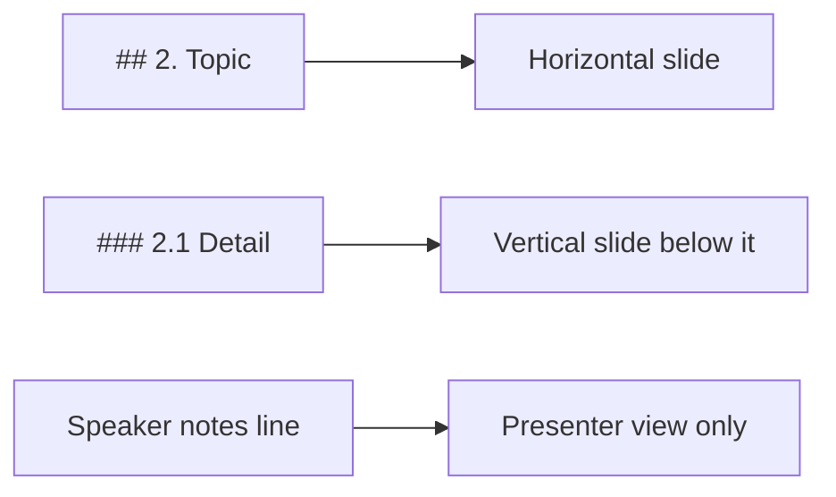

# OUTLINE — Outline first: building better decks in two phases

<!-- status: version 1.0 | phase 2 | last written 2026-11-02 | approved: yes -->

**Status:** v1.0, approved November 2, 2026. Demo outline for the Field Guide style; it uses every base and style tag at least once.
**Session:** 15-minute demo
**Facts verified:** November 2, 2026

## Changes by version (outline-only working aid)
- v1.0: demo outline.

## Central message
Get the content right in cheap text, tag it with what each part *is*, and let the deck be generated once from that.

---

## Time plan (outline-only working aid)

| # | Section | Live (min) | Priority |
|---|---|---|---|
| — | Title and agenda | 1 | Core |
| 1 | Why outline first | 3 | Core |
| 2 | Phase 1: the outline | 5 | Core |
| 3 | Style tags | 4 | Core |
| 4 | Phase 2: the deck | 2 | Brief |

---

## Front matter: Title and agenda [All]
- Series: Field Guide demo
- Title: Outline first: building better decks in two phases
- Framing line: Write it, tag it, approve it, then build it once.
- Speaker notes: This deck is generated from examples/field-guide-demo/OUTLINE.md. Every base and style tag in the outline appears on at least one slide.

---

## 1. Why outline first [All] [Core]

Main points:
- Text is cheap to write, revise, and re-read. A finished deck is expensive on all three. [Seed]
- Every "redo the deck" pays for the whole deck again. [Seed]
- Coding agents are advised to work the same way: plan in text, approve, then build. [Research] ([Claude Code best practices](https://code.claude.com/docs/en/best-practices))
- Typical deck revisions on your team: [TBD: number of full-deck revisions per talk]

> [!REMEMBER]
> Iterate on the outline. Build the deck once.

Speaker notes: Ask how many times people have rebuilt a deck from scratch in the last month.

### 1.1 The cost of rebuilding [All] [Research]
- Suggested visual: cumulative effort over six revisions, text-outline revisions vs. full-deck rebuilds, illustrative.
- Revising an outline touches a few hundred words; revising a built deck means regenerating and re-checking every slide. [UNVERIFIED: not measured; based on the size of each artifact]

### 1.2 [Myth vs fact] What people believe about decks [All]
Myth: Starting with slides is faster.
Fact: It feels faster, but slides built before the content settles have to be redone when it changes.
Myth: An outline is extra work.
Fact: The outline becomes the deck's structure, speaker notes, and source list.

### 1.3 What it looked like in practice [All] [Seed]

> [!FIELDNOTE]
> One internal talk went through six outline revisions in text, then a 142-slide deck was generated in a single build pass. Later changes went to the outline first.

- The outline also became the deck's speaker notes and source list.
- Speaker notes: Keep the example anonymous.

---

## 2. Phase 1: the outline [All] [Core]

Main points:
- Numbered sections map straight to slides: top-level sections are horizontal slides, subsections are vertical ones. [Research] ([Reveal.js vertical slides](https://revealjs.com/vertical-slides/))
- Two state files carry progress between chats: OUTLINE.md and DECISIONS.md. [Seed]
- Phase 2 starts only when DECISIONS.md records approval. [Seed]

### 2.1 Structure maps to slides [All]

> [!TIP]
> Freeze numbering from v0.2 on. New sections get the next number; the time plan sets the order.

### 2.2 The approval gate [All]
- DECISIONS.md logs dated decisions as Proposed or Decided.
- The gate line: `Decided · Outline v1.0 approved; Phase 2 begins.`

> [!WATCHOUT]
> Without the gate line, a casual "can I see a slide?" starts Phase 2 early and the deck drifts from the outline.

### 2.3 [Quick check] Where does a speaker note end up? [All]
Question: An outline bullet starts with `Speaker notes:`. Where does it appear in the deck?
Options:
- On the slide, in small text
- In the presenter view only
- In the agenda
Answer: In the presenter view only. It becomes an `<aside class="notes">` and is never visible on the slide.

Speaker notes: Pause for answers before revealing.

### 2.4 [Try it yourself] Tag one section [All]
Time: 5 minutes
Steps:
1. Pick a section of a talk you are working on.
2. Rewrite it as `## N. Title` with three main points.
3. Add one callout where it fits: a tip, a warning, or something to remember.
4. Ask Claude which slide type would suit one of the subsections.
Expected outcome: a section that already reads like a horizontal slide, with one tag you could render.

### 2.5 [Recap] Phase 1 in three points [All]
Points:
- Numbered sections become slides.
- State files, not chat history, carry progress.
- Approval is a recorded decision.

---

## 3. Style tags [All] [Core]

Main points:
- Tags say what a piece of content *is*: a tip, a hazard, a quiz. The style guide decides how each one looks. [Seed]
- Callouts use GitHub's alert syntax, so outlines stay readable as plain Markdown. [Research] ([GitHub: alerts](https://docs.github.com/en/get-started/writing-on-github/getting-started-with-writing-and-formatting-on-github/basic-writing-and-formatting-syntax#alerts))
- Swap the style guide and the same outline renders in a different theme. [Seed]

### 3.1 Callout syntax [All]
- `> [!TIP]` on its own line, then the text, each line starting with `>`.
- Optional title after the type: `> [!WATCHOUT] Don't skip the gate`.

> [!UNDERTHEHOOD]
> GitHub renders five alert types natively (as of November 2, 2026). Custom types such as FIELDNOTE show on GitHub as an ordinary quote; the deck build is what gives them their look.

### 3.2 From tag to slide [All]
- Suggested visual: a three-column table: tag in the outline, what it is, what the deck shows.

---

## 4. Phase 2: the deck [Technical] [Brief]

Main points:
- One self-contained HTML file; Reveal.js and Mermaid from pinned cdnjs versions. As of November 2, 2026 [Research] ([cdnjs: reveal.js](https://cdnjs.com/libraries/reveal.js))
- Build horizontal slides first, then vertical slides by priority. [Seed]
- Verify every slide before calling it done. [Seed]

### 4.1 Verify every slide [Technical]
- Visible, no overflow, no footer collision, diagrams rendered, no console errors.
- Then look at screenshots.

> [!WATCHOUT]
> Claude's in-chat preview doesn't load CDN scripts, so a correct deck can look broken there. Test in a real browser.

---

## Source reconciliation (outline-only working aid)

| Topic | Conflict | Resolution |
|---|---|---|
| (none in this demo) | | |

## Coverage gaps (outline-only working aid)
- Demo only; not a complete treatment of the method.
