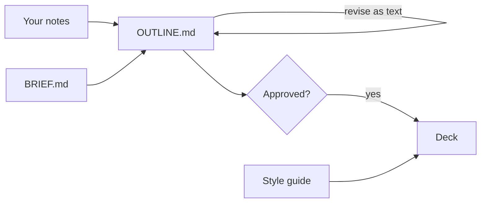

# OUTLINE — Outline First: How to Get Claude to Build the Deck You Actually Want

<!-- status: version 0.1 | phase 1 | last written 2026-11-05 | approved: no -->

**Status:** Phase 1 in progress; outline not yet approved.
**Session:** AI Learning Day, [TBD: November 9, 2026?], 11:00–11:45 AM; 35 minutes including Q&A
**Facts verified:** November 5, 2026

## Changes by version (outline-only working aid)
- v0.0: placeholder created.
- v0.1: first full draft from BRIEF.md revision 2, the template files, and research checked November 5, 2026.

## Central message
Get the content right in a text outline that Claude keeps in project files, tag what each part is, approve it, then build the deck once.

---

## Time plan (outline-only working aid)
Rows in live presentation order. "Full" is the time to cover everything in the section; "Live" is the time it gets in the session. The two Try it yourself activities (4.4, 7.1) are self-guided and not in live time.

| # | Section | Full (min) | Live (min) | Priority |
|---|---|---|---|---|
| — | Title and agenda | 1 | 1 | Core |
| 1 | Why asking for slides first goes wrong | 7 | 5 | Core |
| 2 | Outline first: the method in one picture | 8 | 5 | Core |
| 3 | Files, not chat history, carry the work | 8 | 5 | Core |
| 4 | Tags: say what it is, let the style decide the look | 12 | 5 | Core |
| 5 | Building and checking the deck | 6 | 2 | Brief |
| 6 | Where it goes wrong | 5 | 2 | Brief |
| 7 | Start your own | 20 | 5 | Core |
| — | Q&A | — | 5 | |
| | **Total** | 67 | 35 | |

---

## Front matter: Title and agenda [All]
- Series: AI Learning Day
- Title: Outline First: How to Get Claude to Build the Deck You Actually Want
- Presenters: Terry Tompkins and Suzanne Edwards
- Framing line: Write it, tag it, approve it, then build it once.
- Date line: [TBD: November 9, 2026?]
- Agenda links to every top-level section, in live order.
- Speaker notes: [TBD: which presenter takes which sections]

---

## 1. Why asking for slides first goes wrong [All] [Core]

Main points:
- Claude can now build a deck in any conversation. Getting a deck is easy; getting the deck you want is the hard part. [Research] ([Claude release notes](https://support.claude.com/en/articles/12138966-release-notes)) As of November 5, 2026
- A deck built before the content settles gets rebuilt every time the content changes. Every "redo the deck" pays for the whole deck again. [Seed]
- Work from one chat isn't reliably there in the next unless it's saved where Claude reads it. [Seed] [Research] ([Chat search and memory](https://support.claude.com/en/articles/11817273)) As of November 5, 2026

> [!REMEMBER]
> Iterate on the outline. Build the deck once.

Speaker notes: Ask the room who has asked Claude for slides and then asked it to redo them. Keep the show of hands short.

### 1.1 [Myth vs fact] What people believe about AI-made decks [All] [Seed]
Myth: Asking for the whole deck at once is the fastest way.
Fact: It's fastest to the first draft. Each later change rebuilds slides that were already fine.
Myth: An outline is extra work.
Fact: The outline becomes the deck's structure, its speaker notes, and its source list.

### 1.2 The cost of rebuilding [All] [Seed]
- Suggested visual: cumulative effort over six revisions, outline revisions vs. full-deck rebuilds. Illustrative, not measured data.
- Revising an outline changes a few hundred words. Revising a built deck means regenerating and re-checking slides. [UNVERIFIED: not measured; based on the size of each artifact]

### 1.3 What it looked like in practice [All] [Seed]

> [!FIELDNOTE]
> An earlier internal talk went through six outline revisions in text. Then a 142-slide deck was generated in one build pass. [TBD: presenters confirm which talk and these numbers]

- Later changes went to the outline first; then only the affected slides were rebuilt.

---

## 2. Outline first: the method in one picture [All] [Core]

Main points:
- Phase 1: build a numbered Markdown outline with Claude, and revise it as text until it's right. [Seed]
- The gate: the presenter approves the outline, and the approval is written down. [Seed]
- Phase 2: Claude builds the deck from the approved outline. [Seed]
- Anthropic gives the same advice for Claude Code: have Claude interview you, write the spec to a file, then build from it in a fresh session. [Research] ([Best practices for Claude Code](https://code.claude.com/docs/en/best-practices)) As of November 5, 2026

Speaker notes: Mention that this deck was built with the same template.

### 2.1 Phase 1: the outline [All]
- Claude researches the topic. Your notes are leads, not the limit. [Seed]
- Each section becomes a slide: top-level sections run across, subsections go below. [Seed]
- Revise by section number ("revise 4.2"). From v0.2 on, numbers don't change. [Seed]

> [!TIP]
> Ask Claude to interview you before it drafts anything, a few questions at a time. ([Best practices for Claude Code](https://code.claude.com/docs/en/best-practices)) [Research]

### 2.2 The approval gate [All]
- DECISIONS.md is a dated log. Claude's suggestions are Proposed; only the approver makes them Decided. [Seed]
- Phase 2 starts only when the log has the approval line. [Seed]

> [!WATCHOUT]
> Without a recorded approval, a casual "can I see one slide?" starts the deck early, and the deck drifts from the outline.

### 2.3 Phase 2: the deck [All]
- Start a fresh chat. Claude builds from the approved outline as written, without new research. [Seed]
- First pass: title, agenda, and every top-level slide. Second pass: the detail slides. [Seed]
- Later content changes go to the outline first; then only those slides are rebuilt. [Seed]

### 2.4 [Quick check] When does Claude start building slides? [All]
Question: You're halfway through the outline and ask, "Can you show me what slide 3 would look like?" What should Claude do?
Options:
- Build slide 3
- Build the whole deck
- Say the outline needs approval first
Answer: Say the outline needs approval first. Slides wait for the recorded approval.

Speaker notes: Pause for answers before revealing.

---

## 3. Files, not chat history, carry the work [All] [Core]

Main points:
- A Claude Project holds instructions and knowledge files that every chat in the project uses. Projects are on every plan, including Free (up to five projects). [Research] ([What are projects?](https://support.claude.com/en/articles/9517075-what-are-projects)) As of November 5, 2026
- Three files hold the presentation's state: BRIEF.md (the settings), OUTLINE.md (the content), DECISIONS.md (what was agreed). [Seed]
- Claude updates the files at checkpoints: a finished section, a decision, an approval, or the end of a chat. [Seed] [UNVERIFIED: Anthropic's docs don't describe Claude writing to project knowledge; presenters to confirm the plan and interface where it works]

> [!REMEMBER]
> If it isn't in a file, the next chat may not know it.

### 3.1 The three state files [All] [Seed]
- Suggested visual: three file cards: BRIEF.md "what this talk is", OUTLINE.md "what it says", DECISIONS.md "what we agreed".
- BRIEF.md: topic, audience, date, sources, style. Filled in by an interview in the first chat.
- OUTLINE.md: numbered sections, tags, and the time plan. The source of truth for content.
- DECISIONS.md: dated, one line each, only ever added to.

### 3.2 [Quick check] What does a new chat know? [All]
Question: You open a new chat in the project. What does Claude reliably have?
Options:
- Everything from your last chat
- The project instructions and files
- Nothing at all
Answer: The project instructions and files. Memory and past-chat search can recall parts of earlier chats, but only the files are a reliable record. [Research] ([Chat search and memory](https://support.claude.com/en/articles/11817273)) As of November 5, 2026

Speaker notes: Pause for answers before revealing.

### 3.3 When Claude can't write the files [All]
- If a chat can't update the files, Claude ends with "Updates for OUTLINE.md" and "Updates for DECISIONS.md", ready to paste, and says the files weren't updated. [Seed]
- To recover, ask a new chat to find that message with past-chat search and apply it. Past-chat search needs a paid plan. [Seed] [Research] ([Chat search and memory](https://support.claude.com/en/articles/11817273)) As of November 5, 2026

> [!WATCHOUT]
> Check the file after Claude says it updated it. File tools can stop working partway through a chat.

### 3.4 Large projects [Technical]

> [!UNDERTHEHOOD]
> On paid plans, when project knowledge nears the context limit, Claude switches to retrieval automatically and can hold up to about 10 times more. ([RAG for projects](https://support.claude.com/en/articles/11473015-retrieval-augmented-generation-rag-for-projects)) As of November 5, 2026 [Research]

- Condense long seed files first: a short header, the content as an outline, and your own comments kept separate. [Seed]

---

## 4. Tags: say what it is, let the style decide the look [All] [Core]

Main points:
- Tags mark what a piece of content is: a tip, a warning, a quiz, a hands-on activity, a speaker note. [Seed]
- The style guide decides what each tag looks like. Swap the guide and the same outline gets a new look. [Seed]
- Callouts use GitHub's alert syntax, so the outline still reads as plain text. [Seed] ([GitHub: alerts](https://docs.github.com/en/get-started/writing-on-github/getting-started-with-writing-and-formatting-on-github/basic-writing-and-formatting-syntax#alerts))
- Claude adds tags while drafting and tells you which ones; you keep or remove them. [Seed]

### 4.1 Callouts: five boxes [All] [Seed]
- Suggested visual: the five Field Guide callouts side by side (Tip, Remember, Watch out, Under the hood, Field note), each with its icon and one-line purpose.
- Syntax: a line `> [!TIP]`, then the text.

> [!TIP]
> One callout per slide at most. When every slide has one, none of them stand out.

### 4.2 Slide types: quizzes, myths, recaps, activities [All] [Seed]
- Quick check: a question; the answer appears on a click.
- Myth vs fact: common beliefs, each corrected on a click.
- Recap: three points that close a section.
- Try it yourself: steps, time needed, and what you should see, so it works without a presenter.

Speaker notes: Point out that this talk uses each of these.

### 4.3 From outline to slide [All] [Seed]
- Suggested visual: two panels: a short tagged outline section on the left, the slide it became on the right, from the demo deck. [TBD: screenshot from examples/field-guide-demo/deck.html]

Speaker notes: If time allows, open the demo deck live and press S to show the speaker view.

### 4.4 [Try it yourself] Tag one section [All]
Time: 5 minutes
Steps:
1. Pick one part of a talk you're working on.
2. Write it as `## 1. Title` with three main points.
3. Add one callout: a tip, a warning, or something to remember.
4. Ask Claude which slide type would suit one detail slide.
Expected outcome: a section that already reads like a slide, with one tag the deck can render.

### 4.5 Same outline, a different look [All] [Seed]
- Point BRIEF.md at a different style guide and rebuild. The outline doesn't change.
- Make your own guide from STYLE-GUIDE-TEMPLATE.md, for example in your team's brand.
- A tag the style guide doesn't know stops the build and gets reported. Nothing is guessed.

---

## 5. Building and checking the deck [All] [Brief]

Main points:
- Claude builds one self-contained web page you can host: topics run left to right, details go down. [Seed] [Research] ([Reveal.js: vertical slides](https://revealjs.com/vertical-slides/))
- Every slide is checked before the deck is called done. [Seed]
- Review it in a real browser. [Seed]

Speaker notes: Keep this short for a mostly non-technical room; the detail is in the slides below.

### 5.1 Two-dimensional decks [Technical]
- Reveal.js: horizontal slides for the walk-through, vertical slides for depth. [Research] ([Reveal.js: vertical slides](https://revealjs.com/vertical-slides/))
- The library loads from a pinned version on cdnjs. The latest listed is 6.0.2. [Research] ([cdnjs: reveal.js](https://cdnjs.com/libraries/reveal.js)) As of November 5, 2026
- Press S for the speaker view with the notes. [Seed]

### 5.2 The check script [Technical] [Seed]
- tools/check-deck.py checks every slide: visible, no overflow, no footer collision, diagrams drawn, no console errors, no leaked tags.

> [!WATCHOUT]
> Claude's in-chat file preview can't load the deck's libraries, so a correct deck can look broken there. Test in a real browser.

### 5.3 Other ways to finish [All]
- Claude Slides now works in any conversation (beta on Enterprise plans). The outline-first part works the same whatever builds the deck. [Research] ([Claude release notes](https://support.claude.com/en/articles/12138966-release-notes)) As of November 5, 2026
- This template builds Reveal.js because it gives a two-dimensional deck that can be hosted as one file. [Seed]
- Speaker notes: [TBD: presenters decide how much to say about Claude Slides]

---

## 6. Where it goes wrong [All] [Brief]

Main points:
- Jumping to slides early: the deck drifts from the outline. Keep the gate. [Seed]
- Treating your notes as the whole topic: Claude polishes them instead of researching. Say outright that they're leads. [Seed]
- Lost work: a chat ends before the files are updated. Write at checkpoints and check the files. [Seed]
- Two authors at once: two people editing one outline from separate chats can overwrite each other. [Seed]

### 6.1 Lessons from earlier runs [All] [Seed]
- Name the presenter. "I am presenting…" makes Claude treat whoever is chatting as the presenter.
- Keep rules that apply everywhere (such as "no names on slides") in their own section.
- Every working tag needs a matching rule to remove it, or it leaks onto slides.

> [!FIELDNOTE]
> In one earlier run, the attribution rule was silently dropped when a neighboring instruction section was rewritten.

### 6.2 Review in a fresh chat [All]
- A new chat isn't anchored to the drafting choices, so it catches more gaps. [Seed]
- Anthropic recommends the same for code: a second session is the easiest independent reviewer. [Research] ([Best practices for Claude Code](https://code.claude.com/docs/en/best-practices)) As of November 5, 2026

---

## 7. Start your own [All] [Core]

Main points:
- Get the template: [TBD: where attendees download it]
- Create a Claude Project, paste the project instructions, and upload the knowledge files. [Seed]
- Start with the kickoff prompt. Claude interviews you and fills in the brief. [Seed]
- Copy-paste prompts cover every stage, from the first outline to changes after the build. [Seed]

> [!REMEMBER]
> Outline, approve, then build once.

### 7.1 [Try it yourself] Set up a project and run the kickoff [All]
Time: 15 minutes
Steps:
1. Download the template from [TBD: location].
2. Create a Claude Project.
3. Paste the text of PROJECT-INSTRUCTIONS.md, everything below the line, into the project instructions.
4. Upload the files in knowledge/, except style guides you won't use.
5. Start a chat and paste the Kickoff prompt from PROMPTS.md.
6. Answer Claude's questions, a few at a time.
Expected outcome: a filled-in BRIEF.md in your project and a five-line summary of your talk from Claude.

### 7.2 The prompt sheet [All] [Seed]
- Suggested visual: a table of the nine stages in PROMPTS.md, one line each: Kickoff, First outline, Revise, Review, Approve, Start Phase 2, Pass 2, Change after the build, Switch style guides.

Speaker notes: The full prompts are in PROMPTS.md.

### 7.3 Beyond Claude Projects [Technical] [Seed]
- The same files work in any tool where Claude can read and write files, such as Claude Code, where they also get version history.

Speaker notes: This deck's outline was built in Claude Code, in a Git repository.

### 7.4 What to bring to the kickoff [All] [Seed]
- Your notes, transcripts, or links. They are leads, not the scope.
- The audience, length, date, and what people should be able to do afterward.
- Who approves the outline.

> [!TIP]
> Condense long or noisy notes first: a short header, the content as an outline, and your own comments kept separate.

### 7.5 [Recap] Outline first in three points [All]
Points:
- Get the content right in text; build the deck once.
- Files, not chat history, carry the work.
- Tags say what it is; the style guide decides the look.

---

## Source reconciliation (outline-only working aid)

| Topic | Conflict | Resolution |
|---|---|---|
| Claude writing to project knowledge | The template (WORKFLOW.md §5) says Claude writes the state files in project knowledge. Anthropic's help center and release notes (checked November 5, 2026) don't describe this, and an open GitHub feature request asks for it. Cowork can write files, and Cowork and chat merged on September 16, 2026. | Keep `[UNVERIFIED]` in 3. Presenters confirm the plan and interface where it works. If it doesn't work broadly, teach the paste-in fallback (3.3) as the normal path. |
| Built-in Slides vs. Reveal.js | PROJECT-INSTRUCTIONS.md says not to use Claude's built-in Slides. Since September 16, 2026, Claude Slides works in any conversation (beta on Enterprise). | Teach outline-first as independent of the output; keep Reveal.js as this template's Phase 2; name Claude Slides as an alternative (5.3). Presenters decide. |
| Source for "plan, then build" | The demo outline cites Claude Code best practices for "plan in text, approve, then build." The current page frames it as "interview me… write it to SPEC.md… start a fresh session to build from it." | Cite the current wording (2, 2.1, 6.2). |
| Projects plan availability | Older help snippets say Projects are for Pro and Team plans. The current article says all users, Free capped at five projects; retrieval for large projects is paid only. | Use the current article, dated As of November 5, 2026. |

## Coverage gaps (outline-only working aid)
- **How attendees get the template.** The repository is private. 7 and 7.1 need a download location. This blocks the "leave with a template" promise.
- **Which Claude plan and interface attendees have.** Enterprise or not, Projects or Cowork. This changes the setup steps in 7.1 and the fallback in 3.3.
- **Presenter split.** Which presenter takes which sections, and the handoff points.
- **Real before/after material.** Confirm the 1.3 field note, and decide whether to show slides from the token-spend talk (described generically).
- **Outside practice.** Thin on how others use AI for presentations (practitioner writing, other tools). Proposed research: a short scan of reputable practitioner sources on AI-assisted deck workflows.
- **A Markdown primer.** A mostly non-technical room may need two minutes on headings, bullets, and `>` quotes before section 4. Proposed: a vertical slide under 2 or 4.
- **Accessibility of the finished deck.** Keyboard navigation and screen readers in Reveal.js. Not researched yet.
